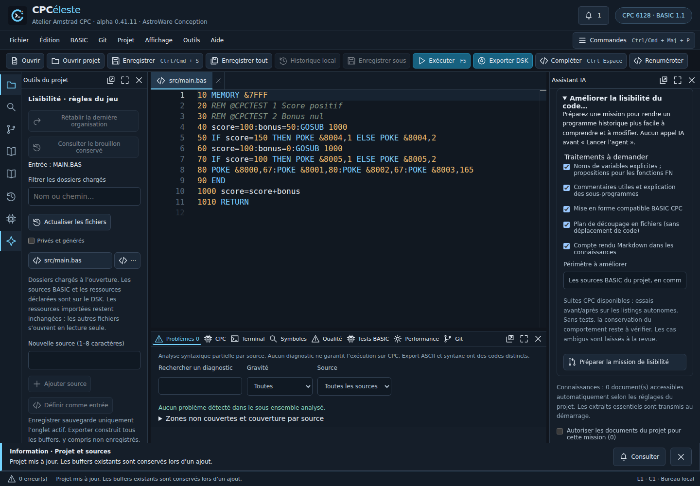

# Lisibilité et tests CPC de l’agent — alpha 0.41.11

**Complément 0.41.20 :** [analyse exploratoire des sous-programmes et des risques de découpage multifichier](basic-module-analysis-alpha.md). Les résultats sont des propositions documentaires, non des transformations automatiques.

**Complément 0.41.19 :** [insertion de commentaires `REM` dans les listings Locomotive BASIC](basic-comment-insert-alpha.md), avec numéro disponible, preview/apply déterministe et documentation des refus, effets mémoire et hypothèses IA.

**Complément 0.41.18 :** [audit qualité, pistes de commentaires et formatage conservateur avec comparaison avant/après](basic-readability-formatter-alpha.md). Le formateur est limité aux lignes simples ; les commentaires restent des suggestions tant qu'ils ne sont pas justifiés et validés.

**Complément 0.41.17 :** [renommage déterministe préparé/appliqué par l'agent](agent-deterministic-rename-alpha.md), avec aperçu, contrôle de portée, collisions et checkpoint. Les transformations refusées par F2 restent refusées ; le découpage automatique n'est pas livré.

**Complément 0.41.16 :** [preuve que les essais ont réellement exécuté les sources modifiées](basic-tested-sources-alpha.md). Une copie autonome ne suffit plus à valider une transformation.

## Améliorer un programme historique

Dans **Agent IA**, ouvrir **Améliorer la lisibilité du code…**. Choisir les traitements, préciser le périmètre puis **Préparer la mission de lisibilité**. Le texte apparaît dans la mission : relire, ajuster et lancer lorsque prêt. Cette préparation ne contacte pas OpenAI. La mission précédente peut être rétablie.

- **Noms** : demander des variables explicites, avec consultation des usages/types possibles. Les fonctions FN et leurs paramètres non qualifiés restent des propositions dans le bilan.
- **Commentaires** : expliquer sous-programmes, invariants, entrées/sorties et hypothèses ; conserver directives de tests et caractères exportables.
- **Mise en forme** : demander une présentation lisible qui conserve chaînes, DATA, numéros, cibles et portée IF/THEN/ELSE.
- **Plan de découpage** : documenter modules, état partagé et chargements. Aucun déplacement automatique de code dans cette première version.
- **Compte rendu Markdown** : conserver les choix et noms remplacés, les cas refusés et les vérifications dans les connaissances du projet.

Le texte prépare une mission agentique : les modifications sont enregistrées pendant son exécution. L’aperçu avant lancement porte sur la **consigne**, pas sur un diff de code préapprouvé. Les changements de code/documents sont comparables ensuite et **Restaurer le checkpoint initial** permet de revenir au départ, sous contrôle de révision. Les consignes guident le modèle ; elles ne constituent pas une preuve de transformation sémantiquement équivalente.

## Essais avant et après

Créer d’abord une suite dans **BASIC → Tests BASIC à la demande…**, selon le [guide des suites](basic-test-suites-alpha.md). Les listings doivent déclarer leurs assertions natives et être autonomes. Importer les ROM 6128 anglaises identifiées dans Configuration ROM. L’agent peut alors lire les suites et en lancer une, sur les buffers courants de la mission.

Chaque listing reçoit un CPC et un DSK indépendants. Les ROM restent locales. Le moteur renvoie réussi, échoué, incomplet, délai, bloqué ou annulé avec provenance ; un blocage ROM n’est jamais un succès. Le bilan affiche les essais dans l’ordre, leurs assertions et la révision courante/antérieure. Les rapports finaux sont conservés dans l’historique existant, dix maximum ; un échec d’archivage reste visible dans la mission.

Limites : 5 suites exécutées par mission (reprises comprises), 60 secondes réelles par suite, 1–15 secondes émulées par listing, 8 listings et 32 assertions par listing. Annuler termine le worker actif. La session CPC interactive reste indépendante. Les scénarios existants peuvent inclure clavier, fichiers et comparaisons d’écran ; les captures ne sont pas transmises à l’IA.

**Un test autonome d’une copie de routine ne teste pas automatiquement le programme principal.** Un succès ne démontre que ses assertions sur les sources indiquées. Sans suite pertinente, le bilan doit déclarer l’absence de vérification comportementale. Une suite échouée ou périmée lors de son dernier essai bloque la validation finale de la mission ; un build DSK reste également requis.

## Vérifications et prochaines étapes

Tests de domaine : lecture/révision requise, ID inconnu, quotas, empreintes, réponses invalides, arrêt, historique, résultat final bloqué. Tests du vrai contrôleur/stockage avec fournisseur et runtime contrôlés : rapports et provenance sans ROM. Parcours navigateur : préparation sans appel, options, restauration de consigne, essais avant/après, adoption des changements et checkpoint. Recette firmware partagée enrichie : worker Node réel avant/après renommage, régression et annulation. Son résultat doit être distingué de la simulation UI dans la PR.

À poursuivre : qualifications FN/portées et renommage sémantique avec diff préalable ; liens explicites entre tests et code testé ; extraction multifichier avec stratégie de chargement vérifiée ; instrumentation et profilage. Aucun gain de vitesse ou secret retrouvé n’est promis.

[Décision d’architecture](../adr/0069-lisibilite-et-tests-agent.md).

La [qualification FN du 15 octobre](basic-fn-qualification.md) fournit maintenant des témoins firmware pour la suite. Le renommage FN dans les missions reste une proposition : l’index ne résout pas encore ces identités.
