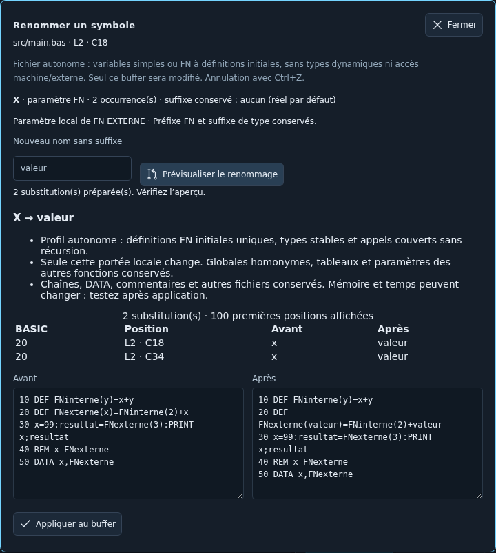

# Renommer une fonction FN ou un paramètre — alpha 0.41.15

F2 couvre désormais un premier profil de fonctions et de paramètres Locomotive BASIC. Il complète le [renommage de variables et tableaux](basic-variable-rename-alpha.md), avec le même aperçu, la même annulation et le même contrôle de révision. [ADR 0074](../adr/0074-renommage-fn-parametres.md).

## Utilisation

1. Placer le curseur dans le **nom après FN**, dans une déclaration ou un appel. Pour un paramètre, choisir sa déclaration ou l’une de ses lectures locales.
2. Appuyer sur **F2**, ou utiliser **BASIC → Renommer le symbole…**. Le panneau distingue fonction, paramètre, scalaire et tableau ; il affiche la portée concernée.
3. Saisir un nouveau nom **sans préfixe FN ni suffixe**. L’outil conserve le préfixe existant, les espaces et le suffixe de type `%`, `!` ou `$`.
4. Prévisualiser les positions et les deux listings, puis appliquer au buffer. **Ctrl+Z** annule l’opération en une fois. Tester avant d’enregistrer ou d’exporter.

La fonction visée est renommée dans sa définition et ses appels reconnus. Le paramètre visé est renommé uniquement dans **sa définition et ses lectures locales**. Une globale, un tableau ou le paramètre d’une autre fonction portant le même nom ne change pas. Les chaînes, DATA, commentaires et autres fichiers restent identiques.

## Premier profil accepté

| Condition | Contrôle |
| --- | --- |
| Programme autonome lancé depuis le début | Aucun état ou type hérité d’une session précédente |
| Définitions initiales | Une définition par ligne, toutes regroupées avant les instructions exécutables ; commentaires et lignes vides possibles |
| Identité de fonction | Une seule définition par radical ; variantes suffixées et redéfinitions refusées |
| Appels | Tous couverts par l’index, une définition correspondante, même suffixe et nombre d’arguments correct |
| Paramètres | Liaisons non ambiguës, aucun doublon ni alias suffixé scalaire dans le corps |
| Fonctions imbriquées | Acceptées si les appels sont couverts et sans cycle ; la récursion est refusée |
| Nouveau nom | Radical absent de tous les identifiants et définitions du fichier, même hors de la portée sélectionnée |
| Types et effets opaques | DEFINT/DEFREAL/DEFSTR, chargement de programme, accès machine/mémoire/temps et autres exclusions du premier renommage restent refusés |

Le profil ne couvre pas toutes les expressions et instructions BASIC. Un appel FN dans une forme non reconnue, un segment inconnu, un budget dépassé ou un diagnostic de couverture tronqué entraîne un refus du fichier entier. L’index général reste volontairement partiel sur les segments FN : le renommage effectue des contrôles supplémentaires dédiés, sans transformer les candidats de navigation en preuve générale.

Les limites communes restent 65 535 caractères, 255 caractères par ligne, 2 000 substitutions, 15 secondes par calcul ; les budgets plus restrictifs de l’index s’appliquent aussi. Seules les 100 premières positions sont affichées, accompagnées des listings complets. La saisie n’analyse pas en continu. Échap ferme le panneau, y compris après un refus initial. Tout changement de source, projet ou révision bloque l’ancien aperçu.

**Les globales des fichiers contenant des FN ne sont pas encore renommées par F2.** Il faudrait recenser leurs usages dans les instructions contenant des appels et dans les corps FN, puis qualifier leurs alias. Le profil de renommage des variables de 0.41.14 reste inchangé sur les fichiers sans FN. Les outils agent ne reçoivent pas de nouvelle permission dans ce lot.

## Exemple et preuve

Ouvrir [rename-functions.bas](../../examples/symbols/rename-functions.bas). Le résultat calculé est **203** : la lecture libre de `x` dans FNinner reste globale, le paramètre `x` de FNouter reçoit 3, puis la globale 99 est ajoutée. Après F5, `PRINT result` permet de lire cette valeur. Renommer le paramètre de FNouter en `value` ne doit pas changer le `x` de FNinner ni le `x` de la ligne principale.

Les [15 témoins FN indépendants](../../tests/fixtures/basic-fn-rename-cases.ts) couvrent fonctions constantes, écritures espacées/accolées et casse, suffixes entier/réel/chaîne, appels imbriqués, paramètres/globale/tableau homonymes, arguments évalués avant liaison et paramètres inutilisés. Les sources attendues après renommage sont écrites séparément du calcul du plan.

`npm run test:basic-rename`, avec `CPC_TEST_ROM_DIR` vers les ROM 6128 anglaises identifiées et le WASM construit, exécute **46 recettes avant/après** : 30 nouvelles exécutions FN et 16 précédentes pour les variables/tableaux. Le rapport inclut désormais les empreintes des deux jeux de fixtures. La CI Linux rejoue ce banc et archive ses verdicts. Aucun octet ROM n’est versionné.

Les tests de domaine contrôlent aussi refus, collisions, coordonnées, CRLF, texte opaque et budgets. La recette Chromium utilise le vrai worker, vérifie les deux portées, les previews exactes, les buffers transmis à l’export, undo et révision périmée ; le port projet est contrôlé. La capture est réelle, sans retouche.

Les noms peuvent modifier mémoire et timing. Ces témoins ne prouvent pas l’équivalence de tout programme, ni une qualification sur matériel ou émulateur indépendant. La suite prioritaire est de relier les suites de tests aux sources réellement transformées, avant d’automatiser davantage les transformations IA ; types dynamiques, redéfinitions et propagation intersource restent ouverts.
