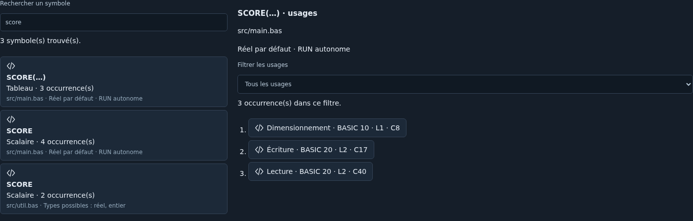
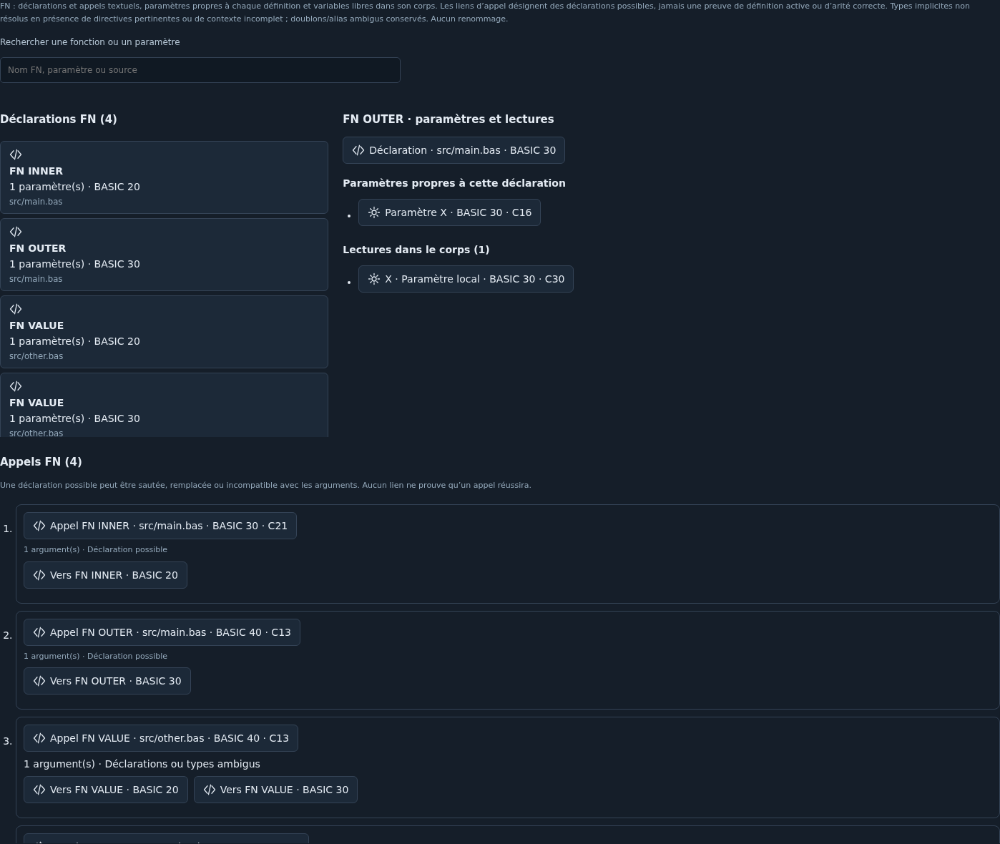

# Symboles, usages et fonctions BASIC — alpha 0.41.12

Mise à jour : 15 octobre 2026. Intelligence IDE 0.41, types possibles en 0.41.1 et [vue FN dédiée en 0.41.12](#fonctions-fn-et-parametres--04112). Les descriptions ci-dessous concernent d’abord la vue des variables globales ; la section FN précise son extension. [ADR 0059](../adr/0059-symboles-usages-basic.md). IDE-015 reste partiel ; aucun renommage sémantique livré.

## Utilisation

Ouvrir **BASIC → Symboles et usages BASIC…**, la commande correspondante dans la palette ou l’onglet **Symboles** des sorties. Choisir la source active ou toutes les sources chargées, puis **Actualiser l’index**. Les buffers et brouillons sont utilisés sans enregistrement préalable. Aucun calcul n’est lancé par l’ouverture du panneau, la frappe, le changement de sélection ou la recherche dans les résultats.

À gauche, rechercher un nom de variable ou de source. Les scalaires et tableaux sont présentés séparément avec suffixe, nombre d’occurrences et source. À droite, filtrer les lectures, écritures, lectures/écritures, dimensionnements ou suppressions. Chaque occurrence indique numéro BASIC, ligne physique et colonne ; cliquer pour sélectionner le nom exact dans l’éditeur. Un onglet fermé mais encore chargé est rouvert au besoin.

Les résultats sont un snapshot. Modifier une source ou son nom rend l’index obsolète et désactive la navigation ; actualiser pour retrouver les liens. Annuler ou remplacer le projet arrête le worker et retire le résultat en cours. Une panne ou un délai dépassé affiche un message ; la relance reste explicite. Masquer puis rouvrir le panneau conserve le snapshot sans recalcul.

## Sens des résultats

| Forme couverte | Rôle textuel |
| --- | --- |
| `a=b+1`, `LET a=b` | a écrit, b lu |
| `a(i)=b(j)` | a tableau écrit, i lu ; b tableau lu, j lu |
| `DIM a(n)` | a dimensionné, n lu |
| `READ a,b(i)` | a et b écrits, i lu |
| `FOR i=d TO f STEP p` | i écrit ; d, f et p lus |
| `NEXT i,j` | i et j lus/écrits ; NEXT sans nom n’invente aucune occurrence |
| `ERASE a,b` | tableaux a et b supprimés |
| `INPUT "Nom";a`, `LINE INPUT "Nom";a$` | cible écrite ; prompt ignoré |
| IF/WHILE, PRINT/WRITE et commandes de lecture couvertes | identifiants des arguments lus ; valeurs et chaînes non exportées |

La casse est ignorée : Score et SCORE sont regroupés. Les suffixes restent distincts : SCORE, SCORE!, SCORE% et SCORE$ sont des entrées séparées. **Sans suffixe, les types possibles sont affichés selon les règles de la 0.41.1 ci-dessous ; le type à une occurrence donnée reste non résolu.** A et A! peuvent désigner une même variable au démarrage ; DEFINT peut au contraire rapprocher A et A%. L’index ne fusionne donc pas ces noms. De même, un scalaire et un tableau de même nom restent séparés. Les dimensions/indices ne créent pas d’identités différentes pour chaque élément.

Chaque source est indépendante : le même nom dans deux programmes ne prouve pas une variable partagée. Ces listes ne sont ni une analyse des chemins d’exécution, ni une preuve d’initialisation, ni un décompte d’exécutions, ni une validation de syntaxe. Un nom seulement lu ne déclenche aucun diagnostic d’erreur. Aucune transformation de source n’est proposée dans ce lot.

## Couverture et exclusions

Affectations, tableaux, DIM, READ, FOR/NEXT, ERASE et INPUT ordinaire sont reconnus. Les arguments de PRINT, WRITE, IF, WHILE, ON, AFTER/EVERY, MODE, MEMORY, ERROR, BORDER/INK, LOCATE, MOVE/MOVER, DRAW/DRAWR, PLOT/PLOTR, POKE, OUT, ORIGIN, SOUND, WAIT, KEY, OPENIN/OPENOUT, RANDOMIZE, FILL, WIDTH, ZONE, RELEASE, SYMBOL et SPEED fournissent les lectures textuelles. Cela ne certifie ni leurs signatures complètes ni leurs effets d’exécution.

Les commandes non couvertes sont omises avec raison, notamment les options de SAVE/chargement complexe pour ne pas transformer une lettre d’option en variable. CALL, RSX, adresses `@`, DEF FN et usages FN, MID$ à gauche et INPUT avec flux restent omis. Les identifiants commençant par FN sont conservativement exclus avec leur segment. DEFINT/DEFREAL/DEFSTR sont relevés séparément ; leurs plages alphabétiques ne sont jamais des variables. Chaînes, commentaires et DATA sont toujours ignorés, y compris leurs mots-clés ou séparateurs apparents.

Numérotation absente/invalide/non croissante, noms dépassant 40 caractères, parenthèses/chaînes non fermées ou cibles reconnues mal formées provoquent une omission explicite. Les autres erreurs de syntaxe relèvent du panneau Problèmes. Les résultats conservés portent l’état **index partiel** si des segments sont omis ; aucune exhaustivité n’est annoncée.

## Budgets et exports

Worker dédié et jetable, délai de 15 secondes, annulation et réponses tardives protégées. Pas de réseau, d’IA, de lecture disque ni d’observation des variables en RAM. 100 sources / 4 Mio de caractères au total ; par source : 1 Mio, 10 000 lignes, 8192 caractères par ligne, 2048 tokens par ligne, 4096 symboles et 20 000 occurrences. Budget global de 50 000 occurrences inspectées ; un index abandonné consomme encore ce qu’il a inspecté. 100 raisons avec compteur des suivantes ; profondeur 64. Les limites symboles/occurrences retirent les résultats de cette source.

Affichage borné à 200 symboles correspondant au filtre et 200 occurrences du symbole choisi. Affiner les filtres ou consulter les exports pour les résultats supplémentaires conservés. Le rapport JSON/Markdown indépendant, version 2, contient **les noms des variables et des sources**, rôles, types possibles, déclarations alphabétiques et positions ; il ne contient ni expressions, ni valeurs, ni commentaires. Cette inclusion de noms est indiquée près des exports. L’export Qualité reste inchangé et ne reçoit pas cet index.

## Exemple et validation

[main.bas](../../examples/symbols/main.bas) affiche **Total 60**. L’index comporte six entrées : JOUEUR, MESSAGE$, SCORES tableau, TOTAL, TOTAL% et TOTAL!. Le nom JOUEUR possède cinq occurrences textuelles : initialisation FOR, trois lectures dans l’affectation/calcul et NEXT. DATA ne produit aucune occurrence supplémentaire.

16 nouveaux tests de domaine vérifient identités, rôles, indices, branches, prompts, exclusions, bornes, confidentialité et coordonnées. Dix nouvelles assertions firmware vérifient casse, suffixes, changement des types par défaut, distinction scalaire/tableau, READ, noms de 40 caractères distincts, ERASE et exemple. Jeu CPC 6128 anglais identifié, moteur intégré ; aucune nouvelle qualification matérielle ou indépendante. Le parcours Chromium vérifie filtres, exports, sélection exacte, navigation intersource, absence de calcul à la frappe, obsolescence et cycle de vie du worker.

Suite 0.41 : types/portées et DEF FN, accès depuis le curseur, navigation enrichie, puis renommage sûr avec aperçu. IDE-015 et lot 2 demeurent partiels ; IDE-017 reste non réalisé.

## Types possibles et déclarations — 0.41.1

Le panneau affiche le type dans chaque entrée et dans le détail. La section **Déclarations de type** rejoint le texte complet du DEFINT, DEFREAL ou DEFSTR, avec la même protection contre les sources modifiées que les usages. Les déclarations sans variable associée restent consultables.

| Situation | Résultat affiché |
| --- | --- |
| Suffixe `%`, `!` ou `$` | Entier, réel ou chaîne explicite, même si d’autres segments sont omis |
| Nom sans suffixe, aucune déclaration pertinente et contexte couvert | Réel par défaut, sous l’hypothèse d’un RUN autonome avec réglages BASIC standards |
| Nom sans suffixe et déclaration pertinente | Union du réel initial et des types déclarés pour sa première lettre dans toute la source |
| Segment omis, POKE, OUT, CONT ou RUN externe | Type implicite indéterminé ; aucun rétrécissement aux seules déclarations visibles |

Les listes de lettres et plages croissantes (`DEFINT a-c,e`) sont reconnues. Les plages invalides, suffixées, inversées ou incomplètes sont omises explicitement. La limite est de 256 déclarations par source ; au-delà, symboles et déclarations de cette source sont retirés. L’interface affiche au plus 200 déclarations, avec compteur du reste ; l’export conserve les déclarations dans le budget.

Ce modèle ne simule pas les chemins. Une déclaration conditionnelle, inatteignable ou située après un retour en arrière reste dans l’ensemble des possibilités. Il ne prétend pas qu’elle a été exécutée, ni que le réel initial reste effectivement accessible à chaque occurrence. Aucun type n’est déduit des valeurs affectées. Les états hérités d’une session, programmes externes et effets machine ne sont pas reconstruits. Les alias textuels restent séparés, même si leurs types possibles se recoupent.

Le rapport JSON passe à la version 2 avec `type` pour chaque symbole et `typeDeclarations` pour chaque source. Le rapport Markdown présente les mêmes informations. Aucun changement au rapport Qualité. Cette tranche prépare la résolution des types et le renommage ; elle ne livre ni les portées DEF FN ni une identité sémantique fusionnée.

Validation : sept nouveaux tests de domaine pour suffixes, plages, branches/sauts, contexte opaque, quotas, confidentialité et séparation des sources. Six nouveaux cas firmware pour plages, recouvrements, suffixes prioritaires, déclaration sautée, tableau entier et changements successifs de type. Recette navigateur : affichage, navigation vers la déclaration, export et blocage du lien obsolète. Voir le [point de reprise](../reprise.md) pour les exécutions effectivement terminées.

## Qualification FN — 15 octobre 2026

La [matrice firmware](basic-fn-qualification.md) précise paramètres, variables libres, types au moment de l’appel, redéfinitions et effets partiels des erreurs. [Exemple exécutable](../../examples/symbols/functions.bas). Ce lot prépare l’extension de l’index ; les exclusions FN, le rapport version 2 et l’absence de renommage restent en vigueur.

## Fonctions FN et paramètres — 0.41.12

Dans **BASIC → Symboles et usages BASIC…**, actualiser puis choisir **Fonctions FN et paramètres**. Les buffers courants sont utilisés, y compris les brouillons. La recherche porte sur noms de fonction, paramètres, variables lues ou source pour les déclarations ; sur nom de fonction ou source pour les appels.

À gauche, sélectionner une déclaration. À droite, lire ses paramètres et les usages dans son corps : **Paramètre local**, **Variable libre (globale)** ou **Liaison ambiguë**. Les boutons sélectionnent précisément le nom dans le code, sans le préfixe FN. Un paramètre et une globale homonymes ne sont pas fusionnés ; les tableaux restent distincts. [functions.bas](../../examples/symbols/functions.bas) illustre cette séparation avec le résultat 104 et la globale 99.

La liste **Appels FN** indique le nombre d’arguments et les déclarations possibles. Cliquer un appel ou un lien rejoint son emplacement ; les onglets chargés peuvent être rouverts. Un lien unique n’est pas une preuve que la déclaration a été exécutée ni que les arguments sont valides. Une redéfinition garde plusieurs candidats. **Aucune déclaration couverte** ne signifie pas une erreur certaine : elle peut appartenir à une forme omise.

Les suffixes explicites sont distingués. Un nom implicite et son alias réel peuvent être rapprochés seulement sous l’hypothèse d’un RUN autonome, sans directive pertinente ni contexte opaque. DEFINT/DEFREAL/DEFSTR ne sont pas simulés dans l’ordre du texte. Les changements de type et paramètres homonymes compatibles rendent la liaison ambiguë ; les [42 témoins firmware](basic-fn-qualification.md) expliquent cette prudence.

### Périmètre et limites

Déclarations `DEF FNnom=expression` ou avec un à plusieurs paramètres scalaires, forme `FN nom`, appels imbriqués, constantes, variables/tableaux et opérateurs arithmétiques/comparatifs/logiques sont relevés. Expressions avec quelques fonctions natives unaires (ABS, INT, LEN, conversions, etc.) reconnues ; ce n’est pas une validation exhaustive de leurs signatures. Appels hors définition relevés dans les affectations scalaires, PRINT/WRITE, IF/WHILE. Les appels dans les indices/cibles, FOR, commandes machine, flux PRINT et autres formes non couvertes sont omis avec raison. Chaînes, DATA et commentaires ne créent aucun usage.

Les segments FN restent exclus de l’ancienne liste des variables/tableaux globaux : le statut général peut donc rester **index partiel** même si leur vue dédiée contient des résultats. Le nom libre d’une fonction ne se lie jamais au paramètre d’une autre définition. Types et définitions actifs à l’exécution ne sont pas reconstruits. Aucun renommage automatique livré ; la mission IA conserve sa restriction FN et son outil de symboles ne retourne pas encore les détails de cette vue.

Budgets supplémentaires par source : 256 définitions, 32 paramètres par définition, 4096 occurrences FN et 8192 liens. Les occurrences FN partagent le budget total existant ; dépassement : retrait complet de l’index de cette source. Les listes affichent 200 éléments et 20 liens par appel, avec indication du reste. Source modifiée : liens désactivés jusqu’à actualisation. Annulation et délai de 15 secondes inchangés.

Les exports **JSON version 3** et Markdown incluent noms des fonctions/paramètres/variables lues, positions, liaisons et candidats. Ils ne contiennent ni expressions ni valeurs ni commentaires. Les identités sont propres à une source et au snapshot, pas des identifiants persistants après édition. Le format du rapport Qualité reste inchangé. [Contrat et décision](../adr/0071-index-fn-et-portees-textuelles.md).
