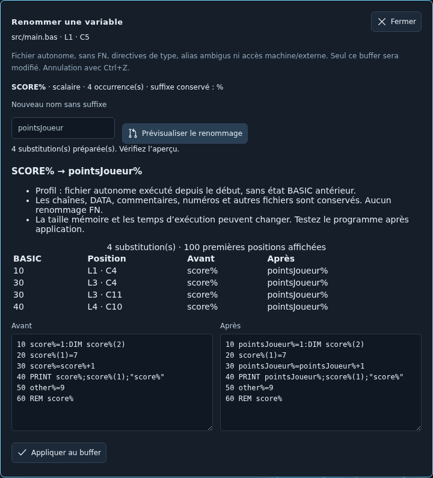

# Renommer une variable BASIC — alpha 0.41.14

Le renommage déterministe complète l’assistance IA à la lisibilité. Il fonctionne localement, sans appel au modèle, sur le fichier BASIC courant. [ADR 0073](../adr/0073-renommage-variables-basic.md), IDE-017 partiel.

## Parcours

1. Placer le curseur **dans le nom** d’une variable ou d’un tableau, puis appuyer sur **F2**. La commande **BASIC → Renommer la variable…** est aussi disponible dans la palette et le menu contextuel.
2. Vérifier le nom, la nature scalaire/tableau, le suffixe et le nombre d’occurrences. Saisir un nouveau nom **sans suffixe** : l’outil conserve automatiquement `%`, `!` ou `$`.
3. Cliquer sur **Prévisualiser le renommage**. Lire les positions et les deux listings avant/après. Modifier le nom retire l’aperçu précédent ; aucune analyse ne part à chaque frappe.
4. Choisir **Appliquer au buffer**. La modification n’est pas enregistrée automatiquement ; **Ctrl+Z** l’annule en une fois. Tester avec F5 ou les suites existantes, puis enregistrer ou exporter normalement.



Pour essayer, ouvrir un fichier contenant :

```basic
10 score%=1:DIM score%(2)
20 score%(1)=7
30 score%=score%+1
40 PRINT score%;score%(1);"score%"
50 other%=9
60 REM score%
```

Placer le curseur sur `score%` en ligne 10, proposer `pointsJoueur` : quatre occurrences scalaires deviennent `pointsJoueur%`. Le tableau `score%`, la chaîne et le commentaire restent inchangés. Proposer `other` est refusé, car `other%` existe déjà. Le tableau peut être sélectionné séparément depuis sa déclaration ou son utilisation.

## Ce qui est accepté et refusé

| Situation | Comportement du premier lot |
| --- | --- |
| Fichier autonome exécuté depuis le début | Variables réelles par défaut et suffixes explicites ; occurrences complètes requises |
| Scalaire et tableau homonymes de même suffixe | Identités séparées ; seule la nature sélectionnée change |
| Nouveau nom | 1 à 40 lettres/chiffres ASCII, première lettre obligatoire ; pas de mot réservé, suffixe ni préfixe FN |
| Nom de destination déjà présent | Refus, quels que soient son suffixe et sa nature scalaire/tableau |
| Plusieurs suffixes pour le nom sélectionné | Refus conservateur : alias de type non résolu |
| DEFINT, DEFREAL, DEFSTR, fonctions FN ou index incomplet | Refus sur le fichier entier, même dans une branche non exécutée |
| Accès machine/mémoire/temps, RSX, chargement ou état externe | Refus explicite, notamment CALL, PEEK/POKE, MEMORY, FRE, TIME, RUN, CHAIN, LOAD/SAVE, CLEAR, `@` et `\|` |
| Chaînes, DATA, commentaires et autres sources | Conservés tels quels ; aucune propagation intersource |
| Modification du document pendant/après calcul | Aperçu périmé, application refusée ; fermer puis relancer F2 |

Le profil impose les formes ASCII prises en charge par le codec, au plus 65 535 caractères, 255 caractères par ligne et 2 000 substitutions. La validation avant/après et le recensement des identifiants refusent les formes non couvertes. Un refus ne signifie pas forcément que le programme est incorrect sur CPC.

Le panneau présente les 100 premières positions et les listings complets. Le worker est annulable, jetable et limité à 15 secondes. Changer de source/projet invalide l’aperçu ; modifier puis annuler le texte ne restaure pas une ancienne autorisation, car la révision a changé. Échap ferme le panneau. Il reste possible de modifier le code pendant l’aperçu.

**Limites de conservation :** la taille des noms modifie la mémoire occupée et peut modifier les temps d’exécution. Aucun renommage n’est une preuve universelle de conservation du comportement, notamment près des limites mémoire. Le profil suppose une exécution autonome depuis le début, sans variables ni types hérités d’une session antérieure. Les fonctions FN, les alias/types dynamiques, le découpage multifichier et les modifications automatiques par l’agent restent hors de ce lot.

## Vérifications reproductibles

- Domaine : résultats exacts indépendants, casse, suffixes, scalaire/tableau, CRLF et lignes vides, collisions, syntaxe/positions invalides, refus FN/types/machine, limites et texte périmé.
- Navigateur : F2 et menu, worker réel, aperçu, aucun calcul à la frappe, annulation/réponse tardive, projet remplacé, suffixe et tableau conservés, un undo/redo, révision modifiée puis annulée et fenêtre étroite. Le port projet est contrôlé ; l’export vérifie les buffers reçus, sans prétendre écrire un DSK dans cette recette UI.
- Firmware : huit paires avant/après indépendantes, soit **16 exécutions CPC réussies** : réel implicite, boucle entière, réel explicite, chaîne, tableau homonyme, ERASE/re-DIM, READ/DATA et GOSUB. Résultats attendus 5, 6, 3, 2, 12, 9, 7 et 3. [Fixtures](../../tests/fixtures/basic-rename-cases.ts), [recette](../../scripts/qualify-basic-rename.mjs).

Exécuter `npm run typecheck`, `npm test`, `npm run build:renderer`, `npm run build:main`, puis `npm run test:editor`. Après construction WASM, fournir les ROM 6128 anglaises externes identifiées au banc existant via `CPC_TEST_ROM_DIR` et lancer `npm run test:basic-rename`. Le rapport `out/basic-rename-qualification.json` contient les empreintes et verdicts, sans ROM. Les sondes de résultat sont ajoutées après le calcul du plan ; elles ne contournent pas le refus de POKE/MEMORY dans les sources de production. CI Desktop Linux rejoue ce banc et archive rapport/capture. Aucun nouveau matériel ni émulateur indépendant qualifié.
