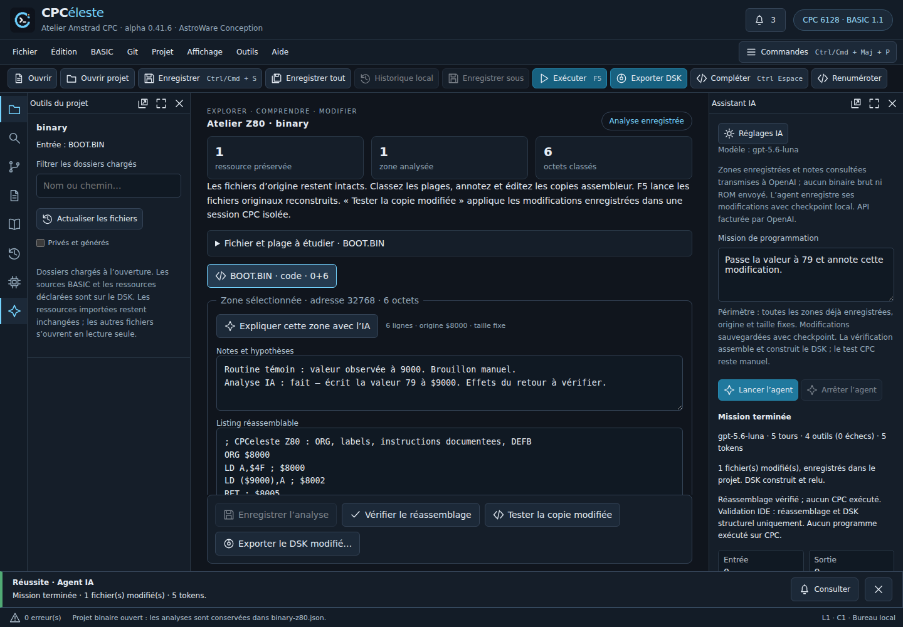
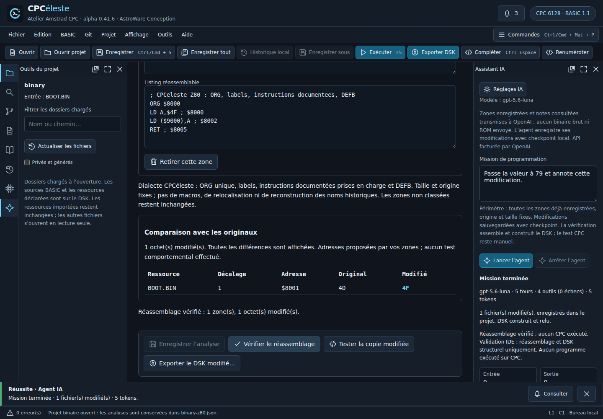

# Comprendre et modifier une routine avec l’agent Z80 — 0.41.6

L’atelier réunit désormais la copie assembleur, les notes et l’agent IA. L’objectif est de travailler sur une routine choisie, en gardant une trace de ce qui a changé. Les originaux du DSK restent intacts. Le [guide de l’atelier binaire](binary-workbench-alpha.md) détaille l’import et le dialecte.

## Parcours conseillé

1. Importer le DSK en **Projet binaire**, choisir l’entrée et créer une petite zone **code présumé** ou **données**. Vérifier son origine. Le formulaire se replie après la création pour laisser la place au listing.
2. Ajouter vos premières observations et **Enregistrer l’analyse** (Ctrl S). Les cartes résument les ressources, les zones et les octets classés ; elles ne mesurent pas une couverture d’exécution.
3. Cliquer **Expliquer cette zone avec l’IA**. Le panneau Agent Z80 s’ouvre avec une mission préparée : expliquer, préserver le listing et les octets, distinguer faits/hypothèses/points à vérifier. Ce bouton ne contacte pas le fournisseur.
4. Dans **Réglages IA**, configurer la clé et choisir le modèle. Relire ou préciser la mission, puis **Lancer l’agent**. API facturée par OpenAI ; budget, consommation, arrêt et continuation sont ceux de l’agent existant.
5. Lire les notes et le bilan. Pour une modification de comportement, donner un objectif précis : par exemple « remplace la constante chargée dans A par 79, conserve l’origine et la taille, annote le changement et construis la copie ». L’agent enregistre les modifications validées sans confirmation par fichier.
6. **Vérifier le réassemblage** dans l’atelier : le tableau présente ressource, décalage dans la charge utile, adresse de zone et octets avant/après en hexadécimal. Le total est exact ; l’affichage se limite aux 128 premières différences, avec mention explicite de troncature.
7. Utiliser **Tester la copie modifiée**, puis **Exporter le DSK modifié…** lorsque le comportement convient. F5 et l’export général continuent d’utiliser les ressources originales reconstruites.
8. Si nécessaire, **Changements** dans le panneau IA montre les notes et listings avant/après la mission. **Restaurer le checkpoint initial** revient aux annotations enregistrées au démarrage ; une modification manuelle postérieure sur disque bloque la restauration, et un brouillon doit d’abord être enregistré.

Capture de l’interface réelle 0.41.6 : stockage, outils, assembleur et contrôleur réels ; réponses OpenAI simulées par la recette, sans appel facturé. Le programme est une création de test, pas un jeu commercial.

## Périmètre transmis et sauvegarde

Une mission peut consulter **toutes les zones déjà enregistrées** du projet binaire, pas seulement celle citée dans le raccourci. Elle ne peut ni créer/supprimer une zone, ni déplacer ses adresses, ni changer sa classification. Les noms et empreintes des ressources, les métadonnées de zones et les extraits demandés sont transmis à OpenAI. Aucun fichier binaire brut ni ROM n’est transmis ; les documents externes et le corpus BASIC ne sont pas accessibles à cette mission.

Les lectures sont bornées à 200 lignes et 16 384 caractères par appel, avec troncature annoncée. Le remplacement exige une lecture préalable, le hash courant et la consultation du dialecte. Il conserve la taille et l’origine ; les instructions invalides sont refusées avant écriture. Les notes restent limitées à 4 000 caractères ; un remplacement IA de listing est limité à 65 536 caractères, même si une zone manuelle plus longue peut être consultée par plages.

Les zones sont enregistrées dans `binary-z80.json`, avec remplacement atomique et révision contrôlée. Le contrôleur conserve un checkpoint initial et les étapes préparées/terminées. L’édition manuelle est verrouillée pendant la mission ; un brouillon Z80 empêche lancement, reprise et restauration. La comparaison devient périmée dès une édition et doit être recalculée après sauvegarde.

La restauration par bouton est disponible pour la mission courante de la session. Le journal privé conserve les snapshots, mais la reprise automatique d’une conversation et la restauration guidée après redémarrage ne sont pas ajoutées par cette tranche. Sauvegarder le dossier projet reste recommandé pour conserver le travail indépendamment de la session.

## Ce que la vérification prouve

`binary_build` assemble les zones et construit réellement une copie DSK. Le nombre d’octets modifiés est mesuré par rapport aux ressources originales. Un contrôle final refuse une analyse devenue périmée. Une mission sans construction finale réussie reste non validée.

Cela **ne prouve pas le comportement du programme**. L’agent n’a pas d’outil d’exécution CPC : il ne peut revendiquer un démarrage, une capture ou un jeu testé. Les appels firmware, banques, interruptions et données interprétées comme instructions peuvent rester inconnus. Les notes IA sont des analyses proposées, jamais des symboles historiques retrouvés. Le prompt demande de distinguer faits, hypothèses et vérifications ; leur exactitude sémantique reste à apprécier.

## Qualification et suite

Recettes reproductibles : `tests/binary-agent.test.ts` (outils, préconditions, pause/reprise, checkpoint, restauration et bornes de comparaison), `tests/binary-workbench-smoke.mjs` (navigateur et IPC Electron), `scripts/qualify-binary-workbench.mjs` (mutation par l’outil agent, puis observation native de 77 et 78 en RAM &9000 avec ROM identifiées). Les réponses modèle sont contrôlées ; aucune qualité d’un modèle distant réel n’est déduite de ces essais.

Prochains lots : qualifier l’assembleur avec une implémentation indépendante, ouvrir l’atelier aux ressources des projets BASIC mixtes, enrichir les références Z80/firmware sourcées et les tests comportementaux accessibles à l’agent. Graphes, banques, relocalisation, compilateurs BASIC et restauration après redémarrage restent ouverts.
