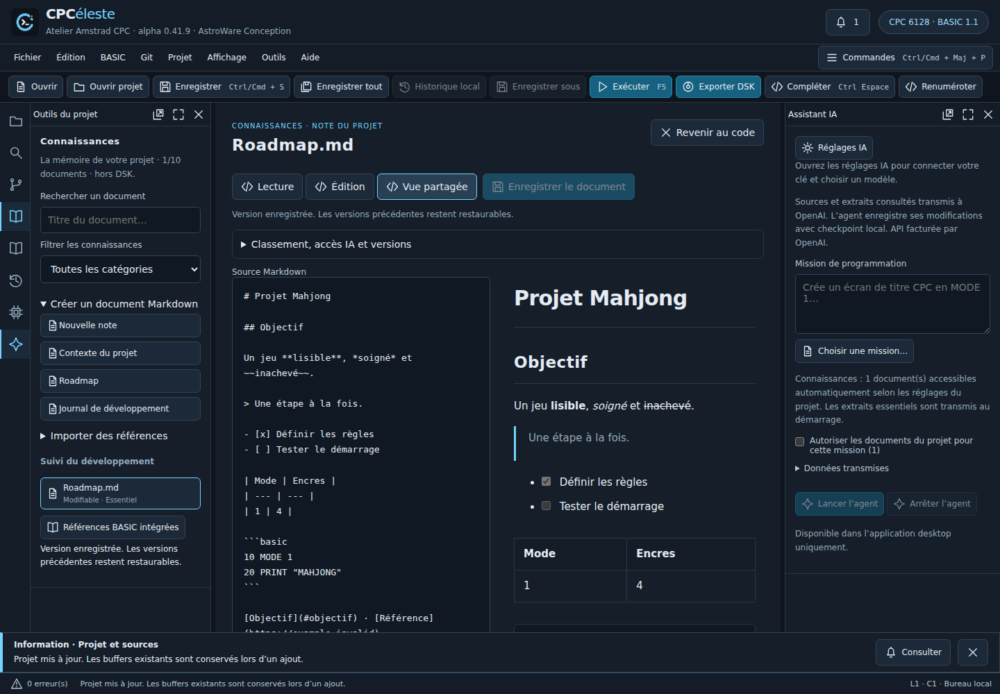

# Connaissances et Markdown — alpha 0.41.9

L’entrée **Connaissances** de la colonne gauche rassemble la documentation du projet. Elle contient les références techniques, la conception, le suivi du développement et les ressources documentaires. Les références BASIC intégrées restent accessibles par un bouton dédié ; elles sont communes à l’IDE.

## Lire un document Markdown

Cliquer sur le document ouvre un lecteur dans la zone centrale. **Lecture** affiche titres, gras/italique/barré, listes et cases de tâches, citations, tableaux et blocs de code. **Édition** montre la source Markdown ; **Vue partagée** juxtapose source et aperçu (empilés si la largeur manque). Les fichiers importés sont en lecture seule ; **Créer une copie modifiable** préserve la référence et ouvre une nouvelle note.

Le HTML brut n’est pas exécuté. Les images référencées ne sont pas chargées automatiquement ; leur bouton ouvre une ressource déclarée ou présente la destination. Les liens vers des titres et les documents déclarés sont navigables. Les URL externes sont affichées pour copie dans le navigateur. Les chemins arbitraires et scripts ne sont pas ouverts. Mermaid, mathématiques et coloration syntaxique des blocs restent du texte/code. Le rendu est borné à 64 K caractères ; les grandes références restent consultables en source. L’édition d’une note est limitée à 64 Kio UTF-8.

## Créer et conserver la mémoire du projet

Ouvrir **Créer un document Markdown**, puis choisir une note vierge, un contexte de projet, une roadmap ou un journal. Le contenu initial reste à compléter ; une case cochée ne prouve pas une exécution. **Enregistrer le document** ou Ctrl/Cmd S dans le lecteur conserve le document. Le bouton général Enregistrer vise également le document quand le lecteur est actif. Enregistrer tout traite d’abord le brouillon documentaire s’il existe, puis les sources BASIC ; un échec documentaire interrompt cette action avant les sources.

Le lecteur conserve le brouillon lors d’un échec. Fermer ou changer de document demande confirmation si le brouillon serait perdu. Le signal de modifications non enregistrées couvre aussi ce brouillon à la fermeture/changement de projet ; il bloque le lancement d’une mission IA. Aucune récupération automatique du brouillon Markdown après crash n’est annoncée.

**Classement, accès IA et versions** permet de choisir la catégorie, enregistrer la politique d’accès et restaurer une version précédente. Une restauration crée une nouvelle version, elle ne supprime pas la version courante. Dix versions précédentes sont proposées. Les fichiers plus anciens restent conservés sur disque, sans purge automatique.

Les notes sont de vrais fichiers Markdown sous documents/ ; le manifeste désigne la version courante. Le titre lisible est présenté dans l’IDE, le nom physique identifie la version. Copier/déplacer le dossier complet conserve corpus et versions ; Git peut les versionner. Aucun document n’est ajouté à la disquette CPC. Modifier directement un fichier référencé à l’extérieur de l’IDE provoque un conflit d’empreinte ; utiliser l’éditeur intégré. Les versions archivées ne sont pas chargées dans le corpus IA.

## Accès de l’agent

| Choix | Effet à la prochaine mission |
| --- | --- |
| Exclu de l’IA | Aucun texte ni métadonnée de ce document dans les outils documentaires, même avec le consentement général |
| Consultable à chaque mission | Catalogue initial ; lectures et recherches à la demande |
| Essentiel | Extrait initial de 4 000 caractères maximum, dans un total de 12 000 ; la troncature est indiquée et la suite reste consultable |

La politique est enregistrée dans le projet et survit à sa réouverture. Les nouvelles notes sont consultables par défaut, avec indication avant enregistrement. Les anciens documents et imports sans politique explicite restent soumis au consentement par mission. Les contenus autorisés peuvent être transmis à OpenAI ; consultation locale et rédaction manuelle ne font aucun appel IA.

BASIC et Z80 utilisent les mêmes lectures documentaires bornées. Le contexte est une source de connaissances, pas une permission d’exécuter des commandes ou de publier. Les références techniques importées ne deviennent pas automatiquement des références firmware qualifiées. L’agent ne crée ni ne modifie encore les fichiers Markdown : cette étape suivra avec journal/checkpoints documentaires dédiés.

## Limites et preuves

Dix documents actifs, 1 Mio par import, 4 Mio au total ; notes modifiables 64 Kio, PDF texte jusqu’à vingt pages, images avec le décodeur existant. Les archives de versions sont conservées en plus de ces limites actives. Pas de synchronisation cloud, index vectoriel, édition HTML, onglets documentaires multiples, recherche humaine plein texte ni qualification simultanée de plusieurs fenêtres.

Tests : `tests/knowledge.test.ts`, `tests/knowledge-smoke.mjs`, régressions Documents/agent/Z80 dans les suites existantes. Le parcours navigateur utilise le vrai ProjectStore, le disque et le renderer ; l’essai de contexte agent utilise un fournisseur contrôlé, sans requête payante. Voir le [point de reprise](../reprise.md) pour les vérifications réellement terminées et l’[ADR 0067](../adr/0067-espace-connaissances-markdown.md) pour la conception.
