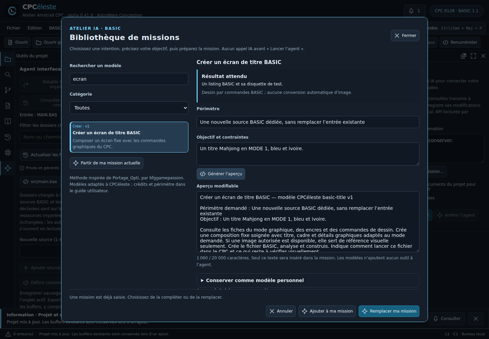

# Bibliothèque de missions IA — alpha 0.41.8

## Préparer une mission

Dans le panneau Agent, choisir **Choisir une mission…**. Cette préparation fonctionne sans clé API. Le catalogue présente quatre modèles BASIC ou trois modèles Z80 selon le projet : compréhension d’un BASIC importé, amélioration BASIC, écran de titre BASIC, recette de vérification ; explication d’une routine Z80, étude d’optimisation et modification ciblée.

1. Rechercher un modèle (accents facultatifs) ou choisir une catégorie.
2. Lire le résultat attendu et les limites de la fiche.
3. Renseigner le périmètre et l’objectif, puis **Générer l’aperçu**. Ce bouton remplace les retouches précédentes de l’aperçu ; une modification de paramètre suspend l’insertion jusqu’à régénération.
4. Retoucher le texte librement. Aucun nom de fichier actif n’est injecté implicitement : le périmètre reste à préciser.
5. **Utiliser cette mission**, ou choisir d’ajouter/remplacer si une consigne est déjà saisie. L’ancienne consigne reste rétablissable jusqu’à la prochaine insertion ou son rétablissement.
6. Relire puis **Lancer l’agent**. La bibliothèque seule ne déclenche aucun appel facturé.

Fermer ou Annuler conserve la mission courante ; les retouches non enregistrées dans le dialogue sont abandonnées. Le focus revient au bouton d’ouverture. La fenêtre utilise les couleurs du thème et s’adapte aux petites largeurs.

## Mes modèles

**Partir de ma mission actuelle** permet d’enregistrer une consigne déjà rédigée. Dans **Conserver comme modèle personnel**, donner un nom, puis enregistrer une copie. Un modèle sélectionné peut être mis à jour ou supprimé ; le dernier modèle supprimé reste rétablissable tant que le dialogue est ouvert. Le texte reste dans l’aperçu après suppression.

Stockage sur cet ordinateur, commun aux projets du même type : vingt modèles au total, noms limités à 80 caractères, objectifs à 20 000 caractères, collection à 200 000 caractères sérialisés. Seuls titre, type et texte sont conservés ; aucun fichier de projet ou secret de configuration n’est ajouté automatiquement. Les modèles restent hors DSK et hors Git du projet utilisateur. Ils ne sont ni synchronisés, ni compris dans l’export des préférences ; suppression du profil applicatif peut les effacer. Le stockage est local non chiffré.

Un échec de stockage est affiché sans revendiquer de sauvegarde. Une collection invalide ou de version inconnue n’est pas écrasée. Une modification détectée depuis une autre fenêtre impose de fermer puis rouvrir la bibliothèque ; verrouillage transactionnel entre fenêtres non qualifié.

## Méthode et crédits

Inspiré de [Portage_Opti](https://github.com/bfggamepassion/Portage_Opti/tree/f5599fc41af0c6a320dca54a45c79da6ff9b5b80), par **bfggamepassion**, étudié au commit `f5599fc41af0c6a320dca54a45c79da6ff9b5b80`. Les principes retenus sont préparation par étapes, distinction faits/hypothèses, périmètre explicite, conservation de l’original et vérification avant d’affirmer un résultat. Les textes sont rédigés pour les capacités propres à CPCéleste. Aucun kit Python, simulateur SkoolKit, désassembleur tiers ou Compendium n’est incorporé. Voir les [attributions](../../THIRD_PARTY_NOTICES.md).

## Capacités et limites

Les modèles ne changent pas les permissions de l’agent. Les consignes d’analyse ne créent pas un mode lecture seule techniquement imposé. L’agent BASIC consulte les sources et références, analyse et construit ; l’agent binaire travaille sur les zones déjà enregistrées, à taille et origine fixes. Les références firmware inconnues ne sont pas inventées. La mission d’écran de titre produit des commandes BASIC, pas la conversion d’un PNG en écran CPC. La recette de test est un plan, pas une suite exécutée.

La bibliothèque ne fournit pas de RUN/capture agent, d’équivalence comportementale, de mesures de performances, de relocalisation ou de portage automatique. Les modèles personnels sont des données utilisateur : même un texte demandant un shell n’ajoute aucun outil au catalogue. La qualité de la réponse d’un modèle réel reste distincte des tests d’interface.

## Vérification

Tests métier dans `tests/mission-library.test.ts` : paramètres littéraux, bornes, collections invalides/versionnées, doublons, quotas, stockage périmé et indisponible. Parcours Chromium dans `tests/mission-library-smoke.mjs`, intégré aux recettes agent BASIC et atelier Z80 : recherche, filtrage, paramètres, aperçu, ajout/restauration, création/mise à jour/suppression/rétablissement, rechargement, focus et absence d’appel IA lors de la préparation. Illustration issue du renderer réel avec données de démonstration, sans appel API payant. Résultats exécutés consignés dans le point de reprise.

## Suite retenue

1. Outiller l’exécution CPC bornée de l’agent et les scénarios avant/après, en réutilisant le moteur et les tests existants (IDE-049/067).
2. Convertir des images par recette déterministe puis proposer l’édition sprites/tuiles (IDE-059/060).
3. Mesurer les routines Z80, exploiter traces et couverture pour le désassemblage (IDE-055/Z80-E).
4. Étudier des portages intermachines ciblés après ces preuves, sans promettre la récupération du source historique.

Les travaux FN/portées BASIC, retokenisation des disquettes pleines et qualification de l’assembleur restent dans la roadmap.
